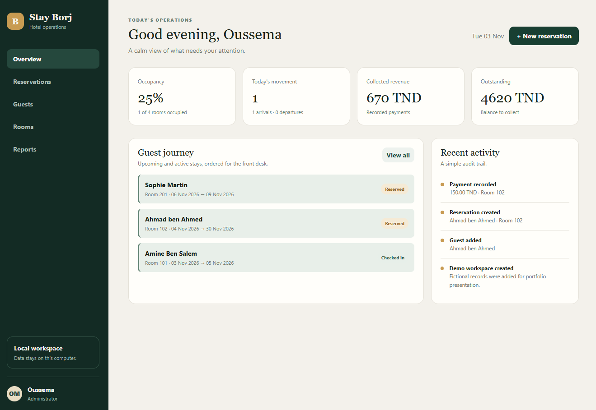
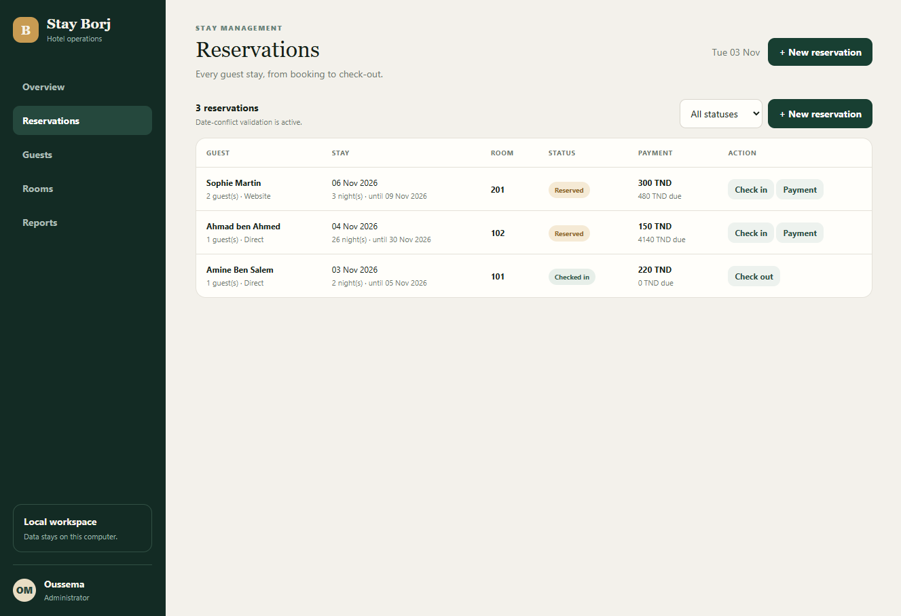
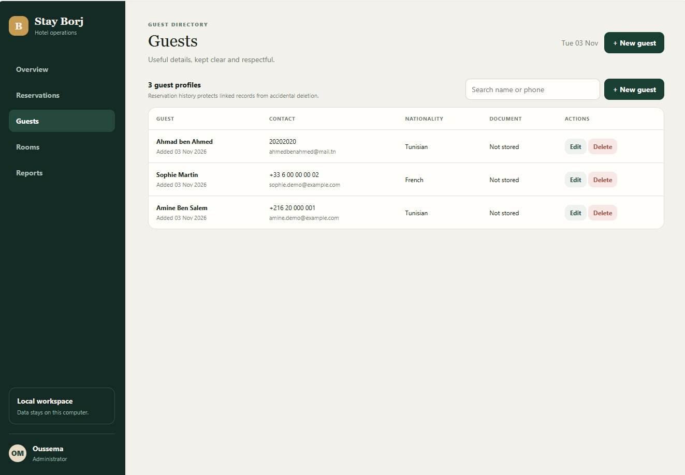
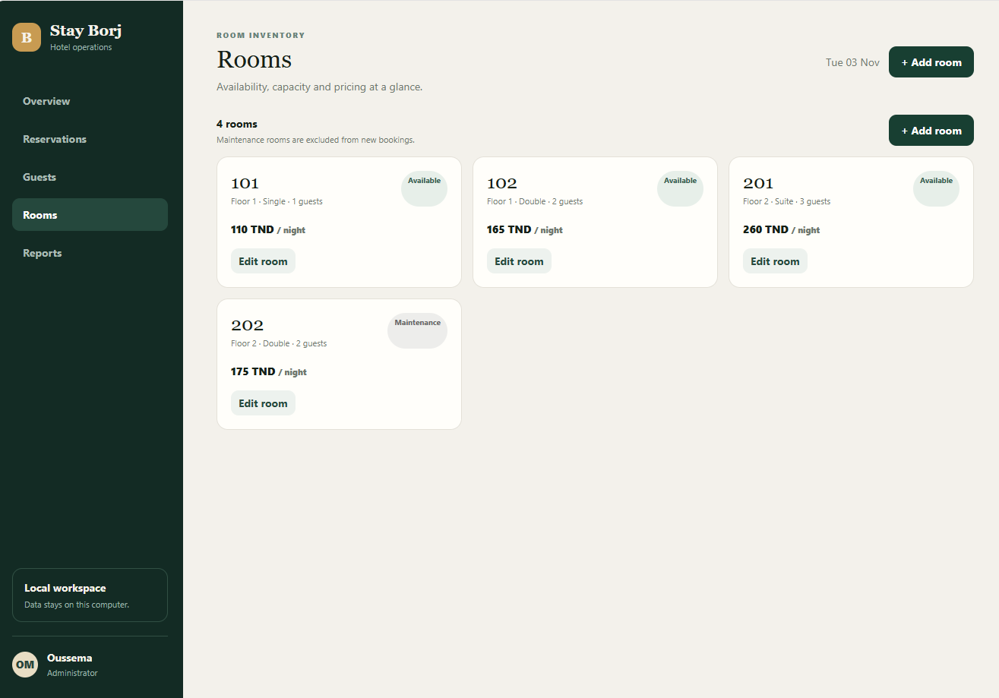
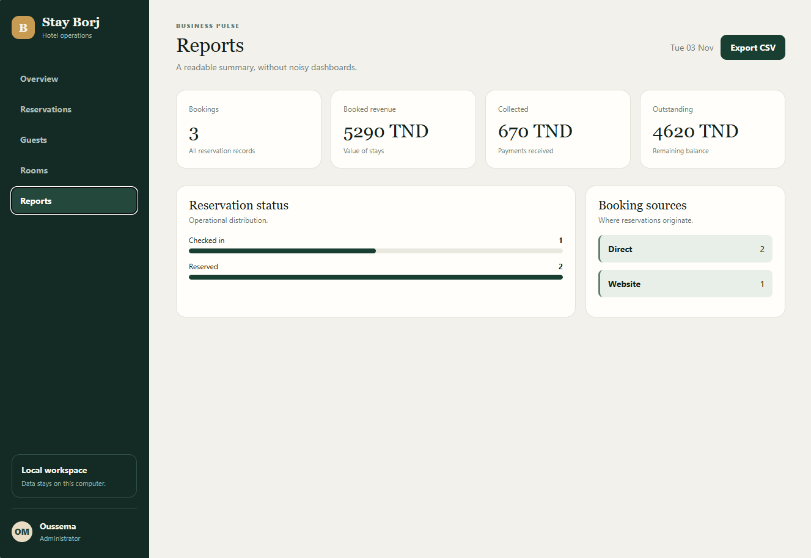
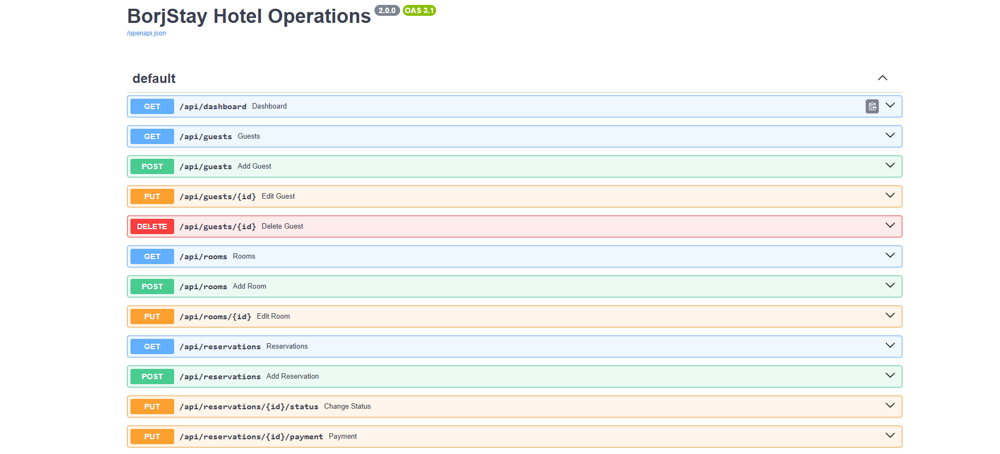

# Stay Borj - Hotel Operations Management Demo

Stay Borj is an independent, local-first hotel operations management demo developed for portfolio and educational purposes.

The application demonstrates how a hotel team can manage guests, rooms, reservations, check-in and check-out operations, payments, and reports through a clear and responsive interface.

> **Important:** This repository is an independently developed portfolio demonstration. It does not contain the original source code, database, private design, confidential business logic, or customer information of any software previously delivered to a client. All displayed data is fictional.

## Project Background

The idea for Stay Borj was informed by practical experience understanding real business and hotel management workflows.

This public version was designed and developed independently from scratch to demonstrate software engineering skills without exposing client-owned source code, confidential systems, private databases, employee information, or customer data.

## Main Features

- Operational dashboard with occupancy, arrivals, departures, revenue, and outstanding balance indicators
- Guest profile management
- Room inventory, pricing, capacity, floor, and status tracking
- Reservation creation and management
- Reservation date-conflict prevention
- Room capacity and maintenance validation
- Check-in and check-out workflows
- Payment recording and outstanding balance calculation
- Reservation status and booking source tracking
- Recent activity history
- Operational and financial reports
- CSV reservation export
- Interactive REST API documentation at `/docs`
- Responsive interface for desktop and mobile
- Fictional demonstration records

## Application Screenshots

### Operations Dashboard



### Reservation Management



### Guest Directory



### Room Inventory



### Business Reports



### REST API Documentation



## Business Rules

- The check-out date must be after the check-in date.
- A room cannot be reserved for overlapping dates.
- A room under maintenance cannot accept new reservations.
- Guest count cannot exceed room capacity.
- A payment cannot exceed the remaining reservation balance.
- Guest records linked to reservation history are protected from accidental deletion.
- Check-in and check-out actions update the operational room status.

These rules are enforced by the backend API, not only by the interface.

## Technology Stack

### Backend

- Python
- FastAPI
- SQLAlchemy
- Pydantic
- SQLite
- REST API

### Frontend

- HTML5
- CSS3
- JavaScript
- Responsive Web Design

### Development Tools

- Git
- GitHub
- GitHub Desktop
- Visual Studio Code

## Project Structure

```text
stay-borj-hotel-demo/
|-- main.py
|-- requirements.txt
|-- README.md
|-- .gitignore
|-- screenshots/
|   |-- dashboard.png
|   |-- reservations.png
|   |-- guests.png
|   |-- rooms.png
|   |-- reports.png
|   `-- api-docs.png
`-- static/
    |-- index.html
    |-- style.css
    `-- app.js
```

## Run the Project Locally

### 1. Clone the repository

```powershell
git clone https://github.com/medoussema2007/stay-borj-hotel-demo.git
```

### 2. Open the project folder

```powershell
cd stay-borj-hotel-demo
```

### 3. Create a virtual environment

```powershell
python -m venv .venv
```

### 4. Allow activation in the current PowerShell session

```powershell
Set-ExecutionPolicy -Scope Process -ExecutionPolicy Bypass
```

### 5. Activate the virtual environment

```powershell
.\.venv\Scripts\Activate.ps1
```

### 6. Install the dependencies

```powershell
python -m pip install -r requirements.txt
```

### 7. Start the application

```powershell
python -m uvicorn main:app --reload
```

Open the application at:

```text
http://127.0.0.1:8000
```

Open the REST API documentation at:

```text
http://127.0.0.1:8000/docs
```

## Reset the Demo Data

Stop the server with `Ctrl + C`, delete the local `borjstay.db` file, and start the server again:

```powershell
python -m uvicorn main:app --reload
```

The application automatically creates a new local database with fictional demonstration records.

## Privacy and Confidentiality

This repository does not include:

- Real hotel customer or employee information
- Private hotel records or production databases
- Passwords, credentials, or API keys
- Client-owned source code
- Original commercial application designs
- Confidential client business rules
- Camera-monitoring functionality
- Private organization workflows

## Public Demo Scope

Stay Borj is a portfolio demonstration, not a production-ready property management system.

A production deployment would additionally require:

- Secure authentication and password hashing
- Role-based access control
- Database migrations
- Automated backups
- PostgreSQL or another production database
- HTTPS configuration
- Automated tests and security testing
- Error monitoring and audit logs
- Data-protection and recovery procedures

## Development Note

AI-assisted tools were used for brainstorming, debugging, documentation support, and code review. The application structure, feature selection, interface customization, business rules, testing decisions, and final implementation were reviewed and managed by the developer.

## Developer

**Mohamed Oussema Marzougui**

Software Developer focused on full-stack applications, business software, Python backend development, REST APIs, SQL databases, AI integration, and workflow automation.

## License

No license is currently provided for this repository.

The source code is publicly visible for portfolio review and educational evaluation. Public visibility does not grant permission to copy, redistribute, sell, or reuse the complete project as a commercial product.
